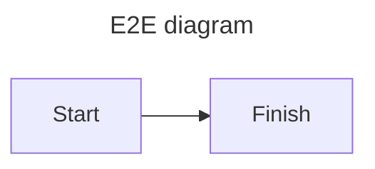

This post exists for the end-to-end tests, which depend on its headings, table, images and diagram.

## E2E first section

| Column | Value |
| --- | --- |
| Name | Fixture |

## E2E image section

<BlogImage
  src="/img/blog/e2e-fixture/image.webp"
  alt="E2E inline image"
  width={640}
  height={360}
/>

## E2E diagram section

